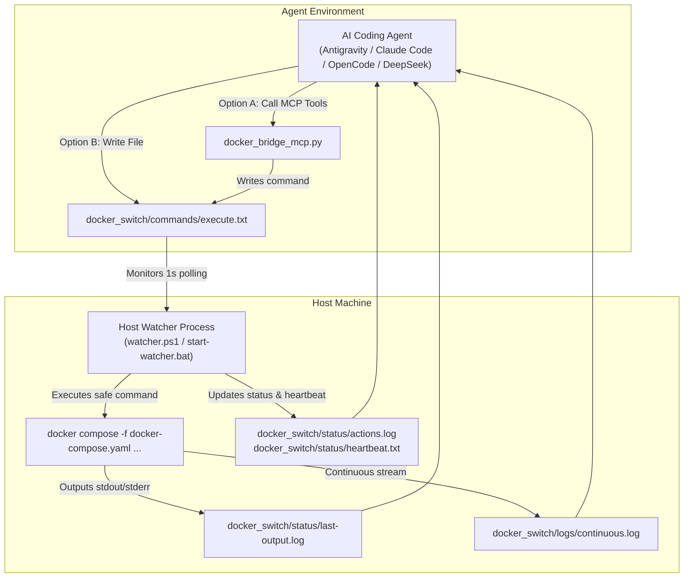

# Docker Bridge Watcher

[](LICENSE)
[](https://learn.microsoft.com/powershell/)
[](https://modelcontextprotocol.io/)

A lightweight, secure, and isolated bridge connecting AI coding agents (Antigravity, Claude Code / ZCode, OpenCode, DeepSeek Harness, Cursor, Windsurf) to host **Docker Compose** environments.

---

## Why Docker Bridge Watcher?

When AI coding agents run in isolated sandboxes, devcontainers, or non-elevated user sessions, they frequently lack direct access to the host's Docker socket or permission to run daemon commands. 

**Docker Bridge Watcher** solves this by establishing a controlled, bidirectional communication bridge between host and agents:

- **Full Docker Compose Support**: Natively executes any valid compose command including profiles (`--profile dev up -d`), service targeting (`restart web`), build flags, and inspections (`ps`, `logs`).
- **Host Console Hardening**:
  - Auto-resizes active console to Consolas 16pt for readability via Win32 API.
  - Automatically disables QuickEdit mode (prevents accidental console freezing when clicking into the window).
  - Highlights active target project prominently: `>>> TARGET PROJECT: [ <name> ]`.
- **Pre-flight Docker Health Check**: Checks Docker Daemon connectivity on startup, highlighting `[ ONLINE ]` (Green) or `[ OFFLINE / ERROR ]` (Red).
- **Multi-Project Isolation**: Uses project-specific mutexes based on path hash (`System.Threading.Mutex`). Multiple watchers can monitor different projects simultaneously without collision.
- **Safety & Injection Defense**: Commands are parsed with PowerShell AST parser. Whitelist verification blocks command chaining (`;`, `&&`, `|`) and prevents unauthorized binaries.
- **Continuous Log Streaming**: Streams unified container logs to `logs/continuous.log`.
- **Universal Multi-Agent Integration**: Works out-of-the-box via Model Context Protocol (MCP) or direct file bridge.

---

## Architecture



---

## Directory Structure

```text
docker-bridge-watcher/
├── README.md
├── LICENSE
├── .gitignore
└── docker_switch/                      <-- Copy this folder into your project root
    ├── start-watcher.bat               <-- Root launcher on host
    ├── commands/
    │   ├── agent-instructions.md       <-- System prompt / instructions for LLMs
    │   ├── execute.txt                 <-- Command buffer monitored by watcher
    │   ├── up.bat                      <-- Manual shortcut: up -d
    │   ├── down.bat                    <-- Manual shortcut: down
    │   ├── restart.bat                 <-- Manual shortcut: restart
    │   └── logs.bat                    <-- Manual shortcut: logs --tail 50
    ├── logs/
    │   └── continuous.log              <-- Real-time background container logs
    ├── status/
    │   ├── actions.log                 <-- History of executed actions and exit codes
    │   ├── last-output.log             <-- Output of last executed command
    │   └── heartbeat.txt               <-- Watcher liveness timestamp (every 1s)
    └── watcher/
        ├── start-watcher.bat           <-- Watcher runner
        ├── watcher.ps1                 <-- Core PowerShell 5.1+ engine
        ├── docker_bridge_mcp.py        <-- Fast MCP server
        ├── agent-instructions.md       <-- LLM tool and file specifications
        └── mcp_configs/                <-- Configuration templates for agents
            ├── README.md
            ├── enable_mcp.bat          <-- 1-click config activator
            ├── disable_mcp.bat         <-- 1-click config remover
            ├── zcode.json              <-- ZCode / Claude Code config
            ├── opencode.json           <-- OpenCode config
            ├── deepseek_harness.json   <-- DeepSeek Harness config
            └── mcp.json                <-- Universal root MCP config
```

---

## Configuration (`docker_switch/config.ini`)

All bridge parameters are cleanly managed in `docker_switch/config.ini`:

```ini
# ===============================================================
# Docker Bridge Watcher - Configuration
# ===============================================================

# 1. Target Project Directory
# Path to directory containing docker-compose.yaml / compose.yaml
# Values:
#   auto           - Uses parent directory (..\) relative to docker_switch
#   C:\path\to\app - Absolute or relative path to any project on disk
PROJECT_DIR=auto

# 2. Safe Mode
# When enabled (true), destructive operations ('rm', 'prune') are blocked.
# Values:
#   true  - Safe mode enabled (default & recommended)
#   false - Safe mode disabled
SAFE_MODE=true
```

---

## Dedicated Agent Installers

The repository provides 1-click installers for each AI agent:

| Script | Target Agent | Actions Performed |
| :--- | :--- | :--- |
| `install-antigravity.bat` | **Google Antigravity (AGY)** | Installs global skill and global MCP server into `~/.gemini/config/`. Works everywhere without copying files. |
| `install-zcode.bat <dir>` | **ZCode / Claude Code** | Deploys `docker_switch/`, generates `.zcode.json` & `.claude.json`, appends rules to `CLAUDE.md`. |
| `install-opencode.bat <dir>` | **OpenCode** | Deploys `docker_switch/`, generates `opencode.json` & `.mcp.json`, appends rules to `OPENCODE.md`. |
| `install-deepseek.bat <dir>` | **DeepSeek Harness** | Deploys `docker_switch/`, generates `.mcp.json`, appends rules to `AGENTS.md`. |
| `install-universal.bat <dir>` | **Cursor / Windsurf / VS Code** | Deploys `docker_switch/` and generates universal `.mcp.json`. |
| `install.bat` | **Master Interactive Menu** | Menu allowing you to choose any agent or deploy manually. |

---

## Quick Start

### 1. Add to Your Project
Run the helper installer for your agent, or manually copy `docker_switch/`:

```cmd
:: Using installer for ZCode
install-zcode.bat C:\projects\my-project

:: Or using master installer
install.bat C:\projects\my-project

:: Or manually via xcopy
xcopy /E /I path\to\docker-bridge-watcher\docker_switch my-project\docker_switch
```

### 2. Start the Watcher on Host
Double-click `my-project\docker_switch\start-watcher.bat`.

The console will launch, verify Docker connectivity, and begin polling for commands:
```text
=================================================================
  Docker Bridge Watcher
=================================================================
  >>> TARGET PROJECT: [ my-project ]
=================================================================
  DOCKER DAEMON : [ ONLINE ] (v27.2.0)
  CONSOLE FONT  : Consolas 16pt
  ANTI-FREEZE   : QuickEdit Disabled
  SAFE MODE     : ENABLED
=================================================================
  Listening for commands in: commands\execute.txt
=================================================================
```

---

## Multi-Agent Setup & MCP Configurator

By default, the MCP server is disabled to keep projects clean.
In `docker_switch\watcher\mcp_configs\`, run `enable_mcp.bat`:
- Running with no arguments opens an **interactive menu**.
- Running with arguments activates instantly:
  - `enable_mcp.bat zcode`
  - `enable_mcp.bat opencode`
  - `enable_mcp.bat deepseek`
  - `enable_mcp.bat universal`
  - `enable_mcp.bat all`
- To remove all MCP configs from a project: `disable_mcp.bat`.
```cmd
enable_mcp.bat universal
```

To remove all MCP configs from the project at any time:
```cmd
disable_mcp.bat
```

---

## Allowed Commands & Safety Whitelist

| Verb | Description | Safe Mode Allowed |
| :--- | :--- | :---: |
| `up` | Starts containers (auto-injects `-d` to prevent hanging) | Yes |
| `down` | Stops and removes containers | Yes |
| `restart` | Restarts all or specified services | Yes |
| `build` | Builds/rebuilds service images (up to 1200s timeout) | Yes |
| `ps` | Lists running container statuses | Yes |
| `logs` | Fetches container logs (`logs --tail 50`) | Yes |
| `exec` | Executes commands inside container (`exec <service> bash`) | Yes |
| `pull` | Pulls container images | Yes |
| `stop` | Stops running containers | Yes |
| `start` | Starts stopped containers | Yes |
| `config` | Validates and views compose configuration | Yes |
| `rm` | Removes stopped containers | Blocked in Safe Mode |

---

## Agent System Prompt Integration

To ensure your agent knows how to use the bridge, append this to your project's `AGENTS.md` or `CLAUDE.md`:

```markdown
## Docker Bridge
- Do not run `docker` or `docker compose` directly inside sandbox shells.
- If MCP is active, call `docker_compose_execute(command="...")`.
- If MCP is inactive, write the command to `docker_switch/commands/execute.txt` (e.g. `up -d`).
- Monitor status in `docker_switch/status/actions.log` and `docker_switch/logs/continuous.log`.
```

---

## License

MIT License. See [LICENSE](LICENSE) for details.
